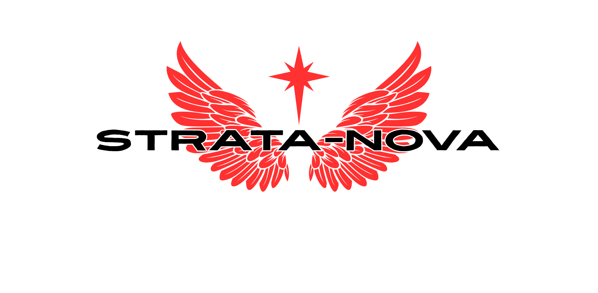

# STRATA-NOVA

STRATA-NOVA models Type Ia supernova ejecta interacting with circumstellar
material (CSM), using one-dimensional grey radiation hydrodynamics.
It is derived from [SuperSNEC](https://github.com/cfremling/SuperSNEC) and
[SNEC 1.01](https://stellarcollapse.org/index.php/SNEC.html).

You can run bare ejecta, attach a wind or constant-density shell, or follow
several shell encounters in one staged calculation. Broadband magnitudes are
approximate and use the code's grey treatment.

## Quick start

Requires GNU Fortran with OpenMP, GNU Make, LAPACK/BLAS and Bash 4+.
From the repository root:

```sh
make -j2
./run_campaign.sh --base example/parameters.quickstart --current --name smoke
```

This runs N20 without CSM for one day. Results are saved in
`campaign_runs/<timestamp>/smoke/`.

```sh
make portable   # build without CPU-specific flags
make debug      # build with runtime checks
make check      # check runner syntax and build
make clean      # remove build products
```

## Choose a model and run

The bundled models are **N1, N3, N5, N20, N40, N100, N200 and W7**.
For a DDT model, the runner selects the matching profile and composition:

```sh
./run_campaign.sh --list-models
./run_campaign.sh --base example/parameters.quickstart --model n100 --name n100_control
```

Run `./run_campaign.sh` for interactive parameter entry. Enter one
`parameter=value` change per prompt, then a blank line to start. For command-line
use, add `--set` options. For example:

```sh
./run_campaign.sh --name uniform_shell \
  --set simulation_mode=single --set csm=active \
  --set mass_scheme=constant_density --set csm_mass_msun=0.01 \
  --set csm_outer_radius_cm=1.0d15 --set csm_temperature_k=1.0d4
```

Unspecified settings come from `parameters`, or the file selected with
`--base FILE`. Custom models, including W7, need matching `profile_name` and
`comp_profile_name` paths. The Badenes wind has a fixed mass-loss history;
`csm_mdot_msun_per_yr` sets the steady wind only.

For a campaign, put one case per line in a text file, using `|` between settings:

```text
control | simulation_mode=single | csm=none | tend=8.64d4
shell | simulation_mode=single | csm=active | mass_scheme=constant_density | csm_mass_msun=0.01 | csm_outer_radius_cm=1d15 | csm_temperature_k=1d4 | tend=8.64d4
```

```sh
./run_campaign.sh --file example/campaign.example --dry-run
./run_campaign.sh --file my_cases.txt --jobs 2 --save campaign_runs/my_cases
```

Each case contains its inputs, log, exit status and `output/`. Staged results
are in `output/final/`. Existing case folders are overwritten with a notice.

## Results and guide

- `lum_observed.dat`: all-frequency grey bolometric luminosity. Staged runs
  apply observer-time integration when enabled; single runs use emission time.
- `magnitudes.dat`: approximate broadband magnitudes.
- `*.xg`: evolving profiles, depending on the output mode.

The [user guide](guides+papers/STRATA_NOVA_GUIDE.pdf) covers the physics,
parameters and staged examples. Its [LaTeX source](guides+papers/STRATA_NOVA_GUIDE.tex)
and [figures](Analysis/figures/) are included.

For a staged run, the supplied plotting script needs Python 3.10+, NumPy and
Matplotlib:

```sh
python3 Analysis/plot_staged_smoke.py campaign_runs/my_cases/CASE/output/final \
  --out Analysis/figures/local
```

Replace `CASE` with your case name. N100 HESMA reference curves and SN 2017cbv
observations are in `Analysis/DATA/`; their sources and conventions are recorded
in [the data README](Analysis/DATA/README.md). Record the code version and
`parameters.used` with any results you share.

## Attribution and distribution

STRATA-NOVA additions are maintained by Alexandru Tudorache. Cite the software
version, Fremling & Hinds (2026) for SuperSNEC, and Morozova et al. (2015) for SNEC.
The [citation metadata](CITATION.cff), [modification notice](NOTICE.md) and
[third-party provenance](THIRD_PARTY.md) give the corresponding details.

The SNEC/SuperSNEC-derived code and original additions retain the inherited
[CC BY-NC-SA 4.0 license](LICENSE). Independently supplied data and components
retain their own conditions. HESMA data require archive acknowledgement and
model-specific citations. For the N1–N1600C suite, cite Seitenzahl et al. (2013)
for hydrodynamic/nucleosynthesis inputs and Sim et al. (2013) for the companion
synthetic light curves and spectra. Their full references and the archive paper
are in `THIRD_PARTY.md` and `CITATION.cff`. Include the acknowledgement:

> This work made use of the Heidelberg Supernova Model Archive (HESMA), https://hesma.h-its.org.

The guide's interaction curves are STRATA-NOVA calculations; separately
identified HESMA points are model references. Credit Seitenzahl et al. (2013)
and the N100 work of Röpke et al. (2012) for those models, Sim et al. (2013) and
Kromer & Sim (2009) for ARTIS products/methods, and Blinnikov et al. (2006) for
STELLA methodology. W7 credits Nomoto, Thielemann & Yokoi (1984) and Thielemann,
Nomoto & Yokoi (1986); Moriya et al. (2023) describes the wind-comparison setup.
For the observations, cite Wee et al. (2018), its CDS/VizieR catalogue DOI and
the VizieR service acknowledgement recorded in `Analysis/DATA/README.md`.

The software licence and the original sources' data terms remain distinct.
Bundling these comparison inputs does not make their original simulations or
measurements STRATA-NOVA work. Attribution and source links accompany them.
